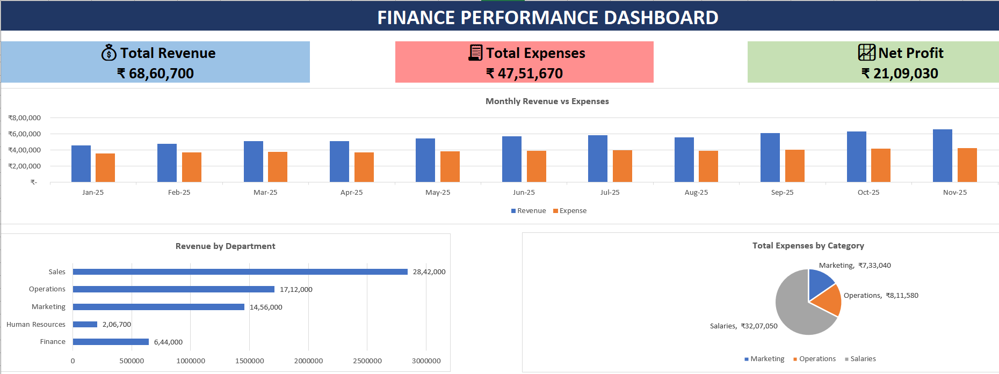
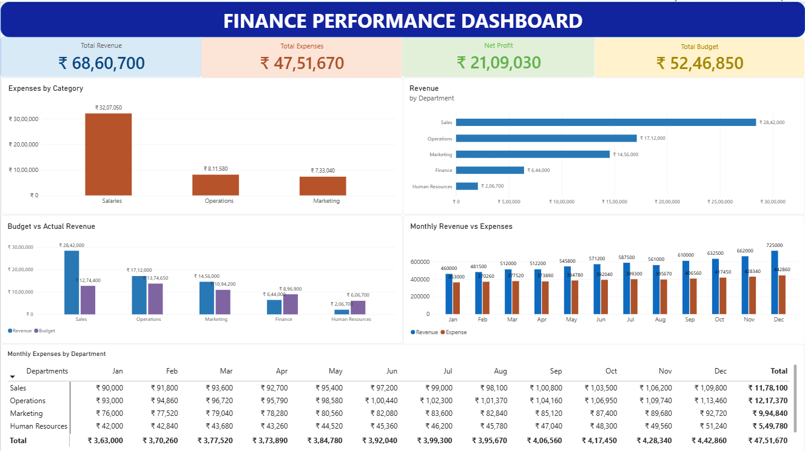
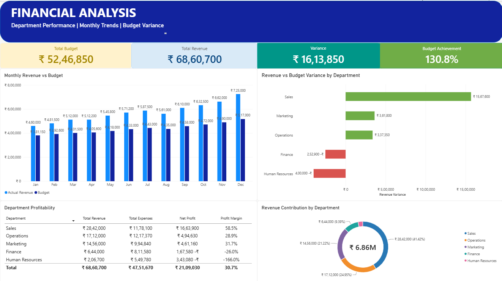

# Finance Performance & Budget Analysis

## Project Overview

This project analyses the financial performance of five departments over the year 2025. The objective is to evaluate revenue, expenses, profitability, and budget performance using SQL, Excel, and Power BI.

The project demonstrates how financial data can be transformed into meaningful business insights to support better decision-making.

## Business Objectives

- Analyse total revenue and expenses.
- Calculate net profit and profit margin.
- Compare actual revenue against budget.
- Identify department-wise financial performance.
- Analyse monthly revenue and expense trends.
- Identify major expense categories.
- Evaluate budget achievement and revenue variance.

## Tools & Technologies

- **MySQL:** Data analysis, joins, aggregations, subqueries, and financial calculations.
- **Microsoft Excel:** Data analysis, PivotTables, KPI calculations, and dashboard creation.
- **Power BI:** Interactive dashboards, DAX measures, data modelling, and visualisation.

## Dataset

The project uses a synthetic financial dataset covering January–December 2025.

| Table | Records | Description |
|---|---:|---|
| Departments | 5 | Department details |
| Revenue | 60 | Monthly department revenue |
| Expenses | 180 | Monthly expenses by department and category |
| Budget | 60 | Monthly department budgets |
| **Total** | **305** | |

Departments included:
- Sales
- Marketing
- Operations
- Finance
- Human Resources

## Key Financial Results

| KPI | Result |
|---|---:|
| Total Revenue | ₹6,860,700 |
| Total Expenses | ₹4,751,670 |
| Net Profit | ₹2,109,030 |
| Total Budget | ₹5,246,850 |
| Revenue Variance | ₹1,613,850 |
| Budget Achievement | 130.8% |

## Key Business Insights

1. **Sales** generated the highest net profit of ₹1,663,900.
2. **Operations** recorded the highest total expenses of ₹1,217,370.
3. **Salaries** were the largest expense category, totalling ₹3,207,050.
4. **December** recorded the highest monthly revenue of ₹725,000.
5. **Human Resources** recorded the lowest net profit at -₹343,080.
6. Overall revenue exceeded the total budget by ₹1,613,850, achieving 130.8% of the budget.

## Dashboard Previews

### 1. Excel Financial Dashboard



[View / Download Excel Dashboard](<Excel/Finance Performance Analysis.xlsx>)

---

### 2. Power BI — Finance Performance Dashboard



[Download Power BI Dashboard](<Power BI/finance_dashboard.pbix>)

---

### 3. Power BI — Financial Analysis



[Download Power BI Report](<Power BI/finance_dashboard.pbix>)  


## Project Structure

```text
finance-performance-budget-analysis/
│
├── data/
│   ├── departments.csv
│   ├── revenue.csv
│   ├── expenses.csv
│   └── budget.csv
│
├── SQL/
│   └── finance_analysis.sql
│
├── Excel/
│   └── Finance_Performance_Analysis.xlsx
│
├── Power BI/
│   └── finance_dashboard.pbix
│
├── screenshots/
│
└── README.md
```

## Skills Demonstrated

- Data cleaning and preparation
- SQL querying and financial analysis
- Data aggregation and joins
- Excel PivotTables and dashboard development
- Power BI data modelling and DAX
- KPI development and financial reporting
- Business insight generation

## Important Note

This project uses synthetic data created for learning and portfolio demonstration purposes. It does not contain actual company or client financial information.

---

**Author:** Prem Bhadoriya

**GitHub:** [prembhadoriya](https://github.com/prembhadoriya)
